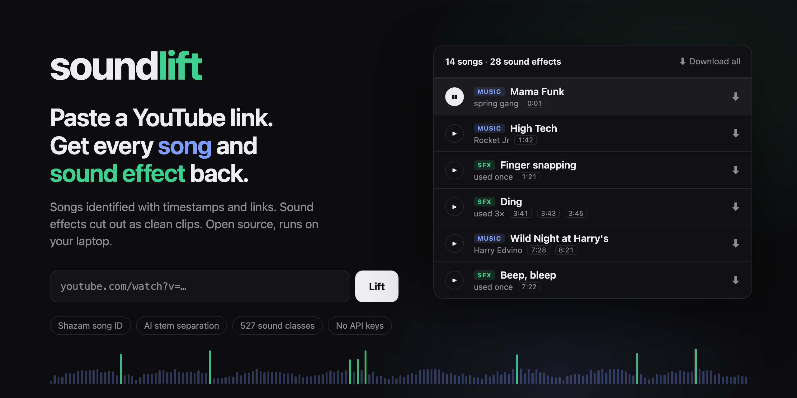
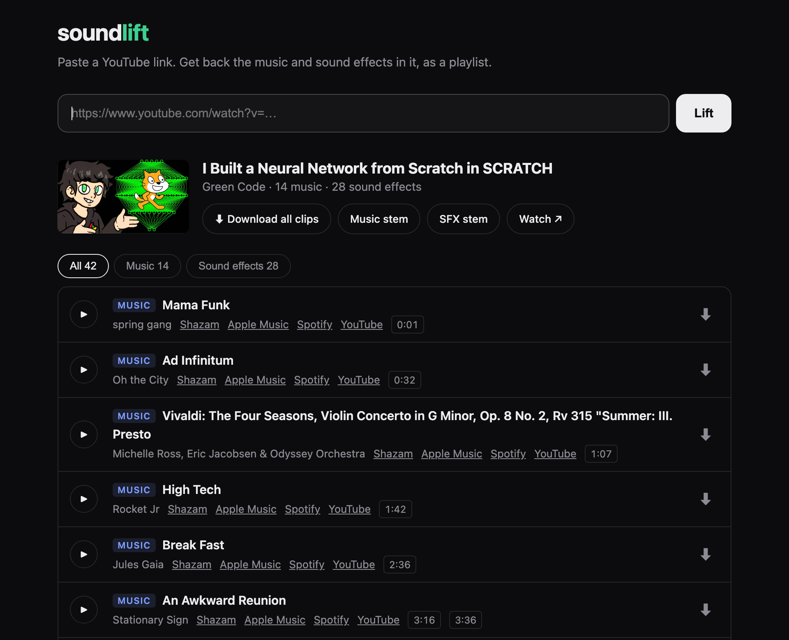

<p align="center">
  
</p>

<p align="center">
  <a href="LICENSE"></a>
  
  
  
  <a href="https://github.com/SamRome1/soundlift/actions/workflows/ci.yml"></a>
</p>

# soundlift

**Paste a YouTube link. Get every song and sound effect in it back, as a playlist.**

Ever watched a video and thought *"what's that song?"* or *"where do I get that whoosh?"* soundlift listens to the whole video and gives you:

- 🎵 **Every song**, identified, with timestamps and links to Shazam, Apple Music, Spotify and YouTube so you can find and license it
- 🎧 **Music it can't identify** (stock-library or custom tracks), cut out as a clip with the voice removed, so you can match it on Epidemic, Artlist and similar
- 💥 **Every sound effect** (whooshes, dings, pops, camera shutters, explosions), cut out as its own clip, labelled, and grouped when it's reused ("Ding, used 3×")
- 🎚️ **Full stems**: the whole video split into music / sound effects / speech
- 📝 **Credits** pulled from the video description

Everything runs on your machine. No API keys, no accounts, no uploads.

## Example

One 11-minute video ([Green Code: *I Built a Neural Network from Scratch in SCRATCH*](https://www.youtube.com/watch?v=5COUxxTRcL0)) → **14 songs** (10 identified by name, 4 unidentified stock tracks) and **28 sound effects**, each with timestamps and a downloadable clip.

<p align="center">
  
</p>

Click any row to play it, use the timestamp chips to jump to that moment on YouTube, or grab everything with **Download all clips**.

## Quick start

You need Python 3.10–3.13 and [ffmpeg](https://ffmpeg.org/) (`brew install ffmpeg` / `sudo apt install ffmpeg`).

```bash
git clone https://github.com/SamRome1/soundlift && cd soundlift
python3.12 -m venv .venv && source .venv/bin/activate
pip install -e .

soundlift serve          # then open http://localhost:8765
```

Or from the command line:

```bash
soundlift "https://www.youtube.com/watch?v=..."
```

The first run downloads three models (~620 MB total) to `~/.cache`. After that, a 10-minute video takes about 7–10 minutes on an M-series Mac. Most of that time goes into cleaning up each clip. Tested on Apple Silicon. NVIDIA GPUs (CUDA) and plain CPU are supported too; CPU is a lot slower.

## How it works

```
YouTube URL
  └─ yt-dlp ─────────────── audio (original language, never the AI dub)
      └─ MRX (fast) ──────── speech / music / sfx stems for the whole video
          ├─ music stem ─── AudioSet classifier finds where music plays
          │                  └─ Shazam, window by window → song + timestamps
          └─ sfx stem ───── onset detection → AudioSet labels → dedupe by embedding
                              └─ for each clip: BandIt Plus re-separates it, averaged with MRX
                                  └─ clips/*.wav + manifest.json
```

| Stage | Tool |
| --- | --- |
| Download | [yt-dlp](https://github.com/yt-dlp/yt-dlp) |
| Speech / music / effects separation | MRX from MERL's [Cocktail Fork](https://github.com/merlresearch/cocktail-fork-separation) (MIT) for the whole video, plus [BandIt Plus](https://github.com/kwatcharasupat/bandit) (Apache 2.0, checkpoint from [ZFTurbo's MSST](https://github.com/ZFTurbo/Music-Source-Separation-Training)) for each clip |
| "Is this music? Is this a whoosh?" | [Audio Spectrogram Transformer](https://huggingface.co/MIT/ast-finetuned-audioset-10-10-0.4593) fine-tuned on AudioSet (527 sound classes) |
| Song ID | Shazam via [shazamio](https://github.com/shazamio/ShazamIO) |

A few details that matter:

- **No false-positive songs.** A real song matches window after window. A single Shazam hit surrounded by misses gets dropped.
- **SFX vs. bleed.** Separation leaks a bit of voice and music into the effects stem. Effects only count if the effects stem is close in loudness to the full mix at that moment. Breaths and gasps are dropped while someone is talking.
- **Clean clips.** The two separation models fail on different sounds (BandIt tends to push booms and whooshes into the music; MRX leaks more on clicks and risers). Averaging them gives cleaner clips than either one alone. On a synthetic benchmark (known speech + music + effects mixed together), SFX clips improved from 3.5 dB to 7.3 dB SI-SDR and music clips from 3.3 dB to 5.6 dB. Music clips are cut from the stretch with the least talking and effects over it, and SFX clips are trimmed and gated so leftover bleed after the effect fades to silence.
- **On-location sounds.** Traffic, wind, doors and crowds are kept but grouped separately from SFX, because they usually came from the camera mic, not the edit.

## Output

```
out/<video-id>/
  manifest.json          everything below, with timestamps
  clips/music_01_<title>.wav
  clips/music_unknown_01.wav
  clips/sfx_01_whoosh-swoosh-swish.wav
  clips/ambient_02_car.wav
  stems/music.wav  stems/sfx.wav  stems/speech.wav
```

## Limitations

- **Shazam only knows released music.** Most stock-library tracks (Epidemic, Artlist, Musicbed) and custom scores won't be identified. You still get a clean clip to search with.
- **SFX labels are AudioSet classes**, so you'll see "Whoosh, swoosh, swish" and "Single-lens reflex camera", not product names from SFX packs.
- **Separation isn't perfect.** Clips are much cleaner than the raw mix, but you may still hear faint music under an effect, or a word under a song. Effects that overlap each other come out together. Deep booms and sub-bass hits are the hardest to separate from music.
- Audio alone can't always tell an edited-in effect from a real-world sound, so some on-location sounds show up as SFX.

## Contributing

Issues and PRs welcome. Run the tests with `pip install pytest && pytest`. The parts with the most room to improve: SFX vs. on-location detection, identifying stock-library music, and faster clip cleaning.

## Use it responsibly

soundlift helps you **find out** what's in a video so you can get it yourself. Identified songs link to where you can stream and license them. The extracted clips are for reference, previewing and searching. They aren't a license. Most music and many sound effects are copyrighted, so check the license before you publish anything you didn't make. Only process videos you're allowed to download under YouTube's terms in your country.

## License

MIT © Sam Rome. `soundlift/vendor/mrx.py` is © MERL (MIT). `soundlift/vendor/bandit/` is © Karn Watcharasupat (Apache 2.0, see its LICENSE), via ZFTurbo's MSST (MIT).
